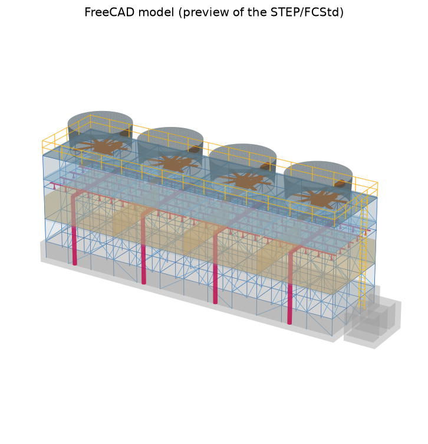
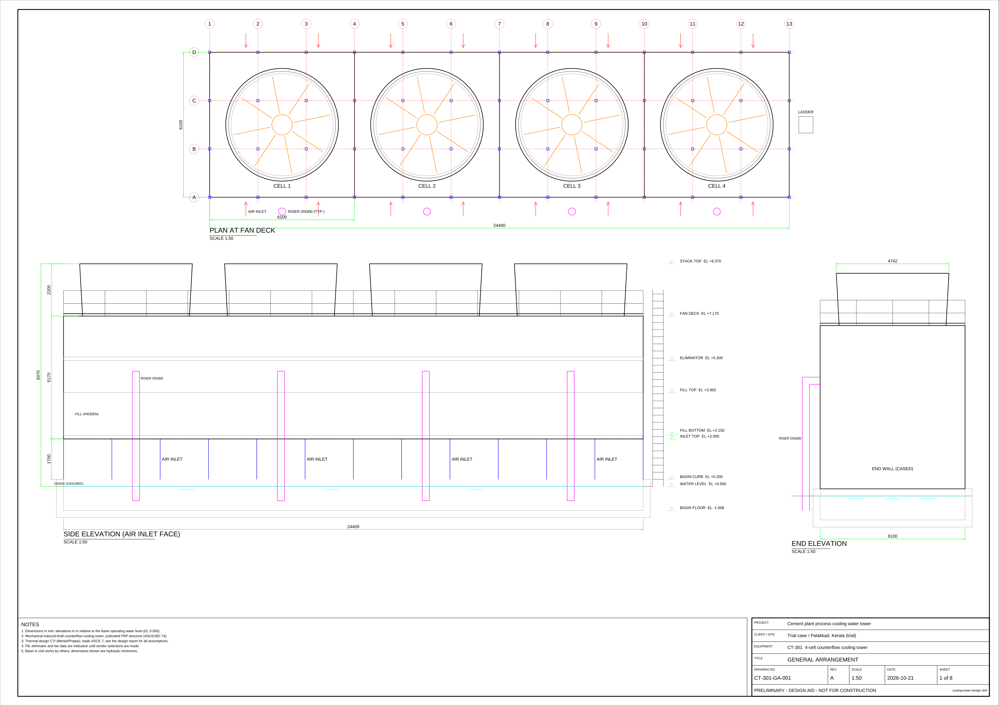
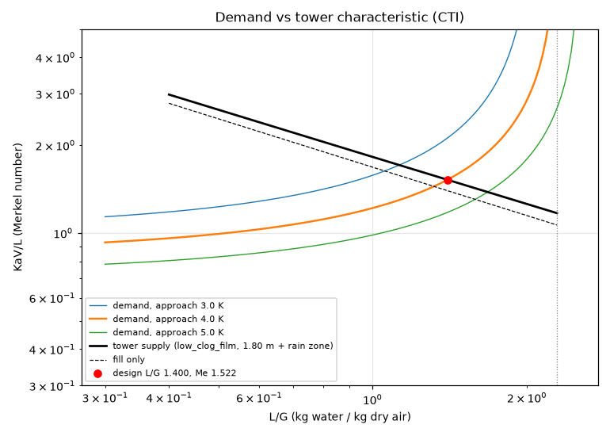

# cooling-tower-design

A Claude Code skill and open-source Python toolchain that designs a complete **mechanical induced-draft counterflow cooling tower** (multi-cell, pultruded FRP structure) from a cooling duty. It produces fabrication-oriented deliverables: a technical report, a datasheet, a bill of materials, an A1 drawing set (DXF / SVG / PDF) and a FreeCAD 3D model (STEP / FCStd).



## What it does

| Stage | What is computed | Main methods / tools |
|---|---|---|
| `thermal` | Merkel demand vs fill + rain-zone supply, design L/G, capability, Poppe exit air, evaporation and plume, rating and ATC-105 performance curves | CTI Merkel (Chebyshev and Gauss), Poppe (Kloppers & Kröger), ASHRAE psychrometrics, CoolProp |
| `size` | Cost optimisation over cells, plan, fill depth and fan; air-inlet height; air-side losses; fan, motor and gear; nozzles, headers and riser; tower pump head; basin and HI 9.8 sump; makeup/blowdown | `fluids`, scipy |
| `structure` | Pultruded FRP frame (ASCE 74 ordinary braced cooling tower), ASCE 7 wind and seismic, LRFD with time-effect factors, member and bolted-connection checks, whole-tower BOM | PyNiteFEA (3D frame), ASCE/SEI 74 |
| `drawings` | 8 A1 sheets: GA, sections, fan deck, water distribution, basin, framing plans with member marks, framing elevations, datasheet | ezdxf, PyMuPDF |
| `model` | 3D model: basin, every FRP member as its true section, fill, eliminators, distribution, casing, deck, stacks, fans and drives, access; STEP re-checked in a fresh session | FreeCAD 1.x (`freecadcmd`) |
| `report` | `REPORT.md`, `DATASHEET.md` (+ Excel), findings, limitations, deliverables list | matplotlib |



## Quick start

```bash
pip install -r requirements.txt          # Python 3.10+
# optional, for the 3D model: install FreeCAD 1.x (found automatically, or set FREECADCMD)

python scripts/run_ct_design.py examples/hvac_2cell.json --out results
```

Run individual stages with `--stage basis|thermal|size|structure|drawings|model|report`. Force a geometry with `--params '{"cells":4,"L":12.2,"W":12.2,"depth":1.5,"fan_D":8.5}'`. Each later stage rebuilds its inputs from `results/data/design_results.json`.

A spec is a small JSON file; anything left out takes a documented default. See [`references/spec_schema.md`](references/spec_schema.md).

```json
{
  "project": {"name": "Cement plant process cooling water tower", "tag": "CT-301"},
  "site": {"design_wet_bulb_C": 27.5, "design_dry_bulb_C": 33.5, "altitude_m": 100},
  "duty": {"water_flow_m3_h": 1800.0, "hot_water_C": 41.0, "cold_water_C": 32.0},
  "tower": {"fill_type": "low_clog_film"},
  "loads": {"wind_speed_m_s": 39.0, "exposure": "C", "seismic": {"Ss": 0.4, "S1": 0.16, "site_class": "D"}}
}
```

Outputs in `--out`:

| Path | Content |
|---|---|
| `REPORT.md`, `DATASHEET.md` | Technical report and datasheet |
| `drawings/` | Each sheet as DXF, SVG, PDF and PNG, plus a merged A1 drawing-set PDF |
| `model/` | `<tag>_tower.step`, `<tag>_tower.FCStd`, `preview.png` |
| `data/` | Design results JSON, BOM and datasheet (Excel/CSV), optimiser candidates, structural results, model checks |
| `plots/` | Demand/supply, performance curves, Poppe profile, air-side losses, optimisation, structure utilisation |

## Use as a Claude Code skill

Clone or link the repository into your skills folder. Claude then uses it whenever you ask to design, size or check a cooling tower; the workflow and review checklist are in [`SKILL.md`](SKILL.md).

```bash
git clone https://github.com/Kiran-1318/cooling-tower-design ~/.claude/skills/cooling-tower-design
```

## Validation

- **Psychrometrics:** match PsychroLib to about 1e-4 and CoolProp (real gas) to within 0.6 %.
- **Merkel number:** reproduces *Perry's Chemical Engineers' Handbook* Example 9 (KaV/L 1.709 vs 1.71) and the counterflow figure of 1.75. Agrees with independent quadrature to within 1.5 %.
- **Poppe:** energy balance closes to 1e-9.
- **Makeup, fan and pump power:** Perry's Example 13 and eqs. 12-13 / 12-14 are reproduced.
- **Structure:**
  - Gravity reactions equal the applied loads.
  - Internal-force reconstruction matches PyNite.
  - Plate-buckling formulas pass their isotropic limits.
  - ASCE 74 λ and C factors are applied.
- **Drawings:** every DXF passes the ezdxf audit, dimensions equal the model values, and FreeCAD imports the DXF.
- **3D model:** the STEP re-imports as valid with the same volume. FRP mass is within 2 % of the BOM.

The suite has 76 tests; run it with `pytest tests` (the model tests are skipped when FreeCAD is not installed).



## Data provenance and limitations

This is a **design aid, not a stamped design**. Every output marks which data is GENERIC or ASSUMED:

- **Generic data:** the film-fill coefficients, the air-side loss coefficients (except the fill) and the fan efficiency. Replace them with vendor curves through the spec.
- **Published data:** the grid-fill and rain-zone correlations, from Vitkovic & Dvorak (2016).
- **FRP:** design follows ASCE/SEI 74, using values from the standard developers' published presentations. Four resistance factors are assumed, and the material values are generic; confirm them against ASCE/SEI 74-23 and the pultruder's ASTM D7290 data.
- **Wind and seismic:** constants follow ASCE 7-16. Supply S_DS / S_D1 from the ASCE Hazard Tool.
- **Not in scope:** crossflow, natural-draft and hybrid towers; steel or timber structures; civil design of the basin.

Full method, equations and sources are in [`references/methodology.md`](references/methodology.md). Design rules of thumb are in [`references/design_guidance.md`](references/design_guidance.md).

## License

MIT, see [`LICENSE`](LICENSE). The engineering outputs are a design aid; responsibility for any design built from them rests with the engineer of record.

## Repository layout

```
SKILL.md                    Claude Code skill: workflow, review checklist, lessons learned
scripts/run_ct_design.py    CLI (all stages)
scripts/ctdesign/           thermal, sizing, air side, fan, hydraulics, basin, structure, FRP, loads, BOM, drawings, report
scripts/freecad/            headless FreeCAD builder and STEP checker (run under freecadcmd)
references/                 spec schema, methodology, design guidance, fill library, FRP profiles
examples/, trials/          example specs (HVAC 2-cell, refinery 6-cell, cement plant 4-cell)
tests/                      pytest suite
```
